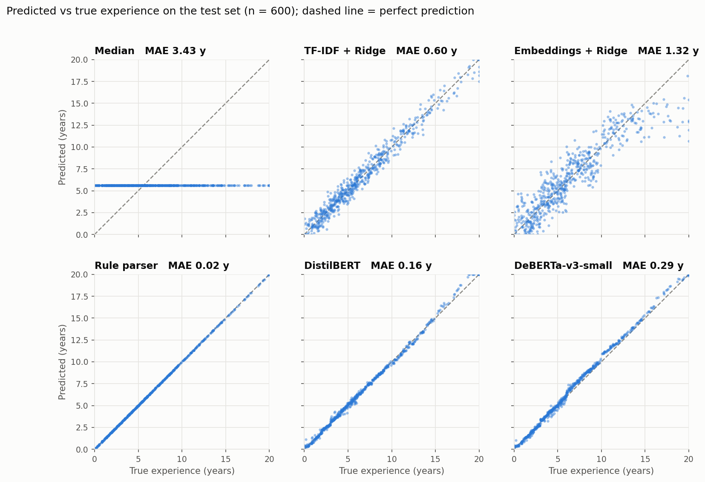
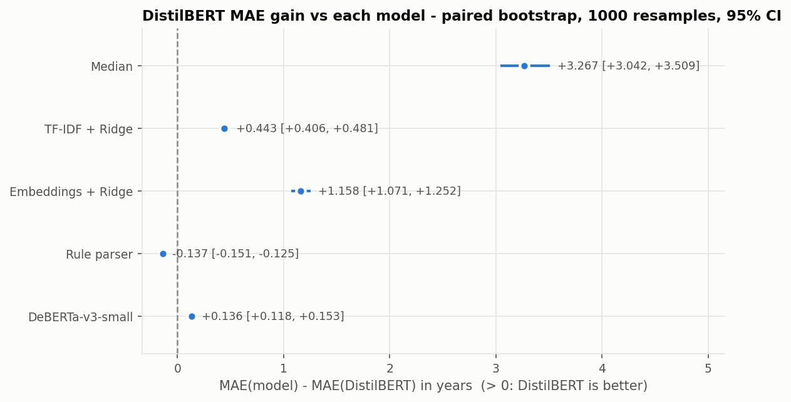
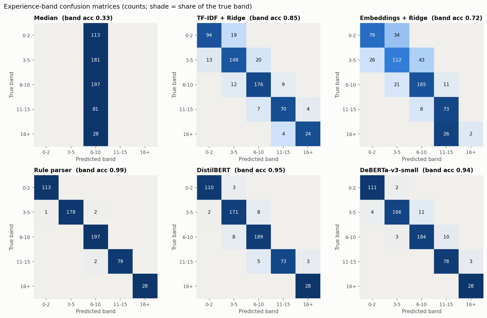
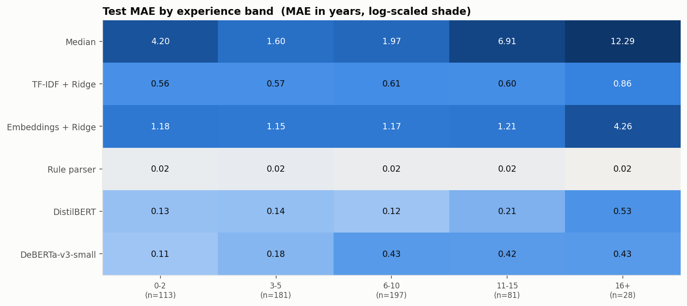
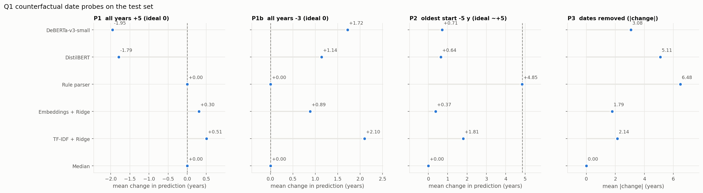
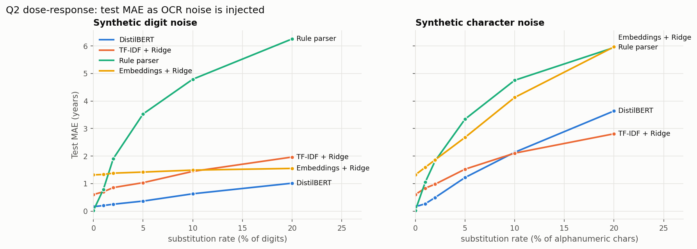
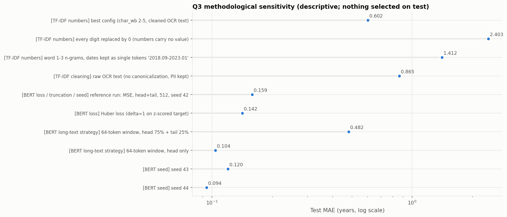

# cv_experience_ocr_bert

Sistema de Document-AI que **lee imágenes de CV con PaddleOCR y predice los años de experiencia laboral (0–20)** con baselines clásicos y un regresor BERT ajustado (*fine-tuned*). Incluye una evaluación con intervalos bootstrap, experimentos de sensibilidad, un análisis de equidad y un panel interactivo en Streamlit.

> **Resultado principal (test, n = 600).** El regresor DistilBERT logra un **MAE de 0,159 años** (Acc ±1 = 99,5 %). TF-IDF + Ridge logra 0,602 y los *embeddings* + Ridge 1,317. La ganancia frente a TF-IDF es de **0,443 años [IC 95 % 0,406–0,481]**. Un analizador de fechas por reglas llega a 0,022, porque en este dataset la experiencia es *exactamente* la suma de los periodos de empleo impresos en el CV. Los experimentos muestran que BERT alcanza esa precisión **sin haber aprendido la aritmética de fechas**, pero es mucho más robusto que las reglas cuando el OCR introduce ruido (§ Preguntas 1 y 2).

---

## Índice
1. [Resultados](#1-resultados)
2. [Estructura del repositorio](#2-estructura-del-repositorio)
3. [Instalación](#3-instalación)
4. [Reproducción paso a paso](#4-reproducción-paso-a-paso)
5. [Decisiones de ingeniería](#5-decisiones-de-ingeniería)
6. [Las cuatro preguntas analíticas](#6-las-cuatro-preguntas-analíticas)
7. [Limitaciones](#7-limitaciones)
8. [Flujo de trabajo en Git](#8-flujo-de-trabajo-en-git)

---

## 1. Resultados

Conjunto de test retenido (600 CVs, nunca usado para elegir modelos ni hiperparámetros). El BERT principal se eligió por el **MAE de validación**.

| Modelo | MAE | RMSE | R² | Acc ±1 | Acc ±2 | Acc ±3 | Acc. banda | Macro-F1 banda | Entreno | Inferencia/CV* |
|---|---|---|---|---|---|---|---|---|---|---|
| Mediana | 3,426 | 4,490 | −0,04 | 0,193 | 0,365 | 0,533 | 0,328 | 0,099 | 0 s | <0,01 ms |
| TF-IDF + Ridge | 0,602 | 0,743 | 0,972 | 0,828 | 0,993 | 1,000 | 0,853 | 0,854 | 6,7 s | 0,5 ms |
| MiniLM *embeddings* + Ridge | 1,317 | 1,779 | 0,837 | 0,492 | 0,785 | 0,928 | 0,718 | 0,613 | 15,8 s | 1,0 ms |
| **DistilBERT (principal)** | **0,159** | **0,231** | **0,997** | **0,995** | **1,000** | **1,000** | **0,952** | **0,953** | 215 s | 0,9 ms |
| DeBERTa-v3-small | 0,295 | 0,365 | 0,993 | 0,998 | 1,000 | 1,000 | 0,945 | 0,946 | 414 s | 1,8 ms |
| *Analizador por reglas (referencia)* | *0,022* | *0,025* | *1,000* | *1,000* | *1,000* | *1,000* | *0,992* | *0,993* | 0,1 s | 0,04 ms |

\* Del texto a la predicción. El OCR añade **365 ms/CV** a todos los modelos (PaddleOCR en una RTX 3060). Tabla completa en `output/tables/model_comparison.csv`.

**Ganancia de MAE de DistilBERT** (bootstrap emparejado, 1.000 remuestreos del test, IC 95 %):

| frente a | MAE del rival | Ganancia (años) | IC 95 % |
|---|---|---|---|
| Mediana | 3,426 | +3,267 | [+3,042, +3,509] |
| TF-IDF + Ridge | 0,602 | +0,443 | [+0,406, +0,481] |
| *Embeddings* + Ridge | 1,317 | +1,158 | [+1,071, +1,252] |
| DeBERTa-v3-small | 0,295 | +0,136 | [+0,118, +0,153] |
| Analizador por reglas | 0,022 | −0,137 | [−0,151, −0,125] |






El MAE de DistilBERT es estable entre ocupaciones (0,146 enfermería – 0,174 docentes) y crece en la banda `16+` (0,53, n = 28), la menos poblada (`output/tables/mae_by_*.csv`).

---

## 2. Estructura del repositorio

```
cv_experience_ocr_bert/
├── app.py                      # Streamlit, exactamente 4 pestañas
├── README.md
├── requirements.txt            # versiones fijadas (Python 3.11, CUDA 11.8)
├── .gitignore / .gitattributes
├── src/
│   ├── utils.py                # rutas, constantes, semillas, límite global del objetivo, bandas
│   ├── download_data.py        # muestreo estratificado por streaming desde PopResume
│   ├── ocr_extraction.py       # PaddleOCR + orden de lectura (XY-cut) + caché JSON
│   ├── ocr_quality.py          # CER/WER (jiwer), precisión de fechas, atribución de errores
│   ├── preprocessing.py        # limpieza, eliminación de PII, enmascaramiento con regex
│   ├── split.py                # 70/15/15 estratificado y congelado con hash
│   ├── baseline_median.py      # Baseline 0
│   ├── baseline_tfidf.py       # Baseline 1
│   ├── baseline_embeddings.py  # Baseline 2
│   ├── baseline_rules.py       # referencia extra: suma de periodos de fechas
│   ├── train_bert.py           # regresor DistilBERT / DeBERTa (HF Transformers)
│   ├── evaluation.py           # métricas, bootstrap, equidad, top-10 errores
│   ├── predictors.py           # interfaz común texto -> años (experimentos y app)
│   ├── experiments.py          # sondas Q1, ruido OCR Q2, sensibilidad Q3
│   └── visualization.py        # figuras de output/figures/
├── scripts/
│   ├── run_pipeline.sh         # reproduce todo
│   └── run_sensitivity.sh      # variantes de BERT para Q2/Q3
├── docs/figures/               # copia versionada de las figuras usadas en este README
├── data/      (ignorado)       # raw/ images + metadata, ocr/ JSON, processed/, splits/
├── models/    (ignorado)
├── output/    (ignorado)       # figures/, tables/model_comparison.csv, metrics/, predictions/
└── video/link.txt
```

---

## 3. Instalación

Requisitos: **Python 3.11** (PaddlePaddle no publica *wheels* para 3.13+), GPU NVIDIA con driver para CUDA 11.8 (opcional pero recomendado) y unos 2 GB de disco para datos y modelos.

```powershell
# con uv (descarga Python 3.11 si no está instalado)
uv venv --python 3.11 .venv
uv pip install --python .venv -r requirements.txt --index-strategy unsafe-best-match
# o con pip
py -3.11 -m venv .venv ; .venv\Scripts\activate ; pip install -r requirements.txt
```

* `requirements.txt` apunta a las *builds* GPU (`paddlepaddle-gpu==3.3.1`, `torch==2.7.0+cu118`) mediante `--extra-index-url`. **Solo CPU:** sustituye esas dos líneas por `paddlepaddle==3.3.1` y `torch==2.7.0`. Nunca instales las dos variantes de Paddle a la vez.
* **Windows:** en un proceso que use ambos frameworks, importa `torch` **antes** que `paddle`. Si no, `import torch` falla con `WinError 127`. El código ya lo hace.
* **Acceso al dataset:** `sumin-yu/PopResume` es *gated*. Acepta sus términos en Hugging Face y crea `.env` en la raíz con `HF_TOKEN=hf_...` (está en `.gitignore`).

Hardware usado en todos los tiempos reportados: Intel Core de 11.ª generación (12 hilos), **NVIDIA RTX 3060 12 GB**, CUDA 11.8, Windows 10, Python 3.11.16, Paddle 3.3.1, PyTorch 2.7.0.

---

## 4. Reproducción paso a paso

Todo el pipeline: `bash scripts/run_pipeline.sh` (~1,5 h en la RTX 3060). Cada paso guarda caché y puede reanudarse.

| # | Comando | Qué hace | Tiempo |
|---|---|---|---|
| 1 | `python -m src.download_data --workers 12` | Índice de 121.768 filas, muestreo 800 × 5 sin foto, 4.000 PNG, decisión del límite | 14 min |
| 2 | `python -m src.ocr_extraction` (`--limit 20` para probar) | PaddleOCR + orden de lectura → `data/ocr/<id>.json` | 24 min |
| 3 | `python -m src.ocr_quality` | CER/WER, fechas, truncados → `output/metrics/ocr_quality.json` | 1 min |
| 4 | `python -m src.preprocessing` (`--selftest`) | Limpieza, PII, enmascaramiento → `data/processed/cvs.parquet` | 10 s |
| 5 | `python -m src.split` | 70/15/15 congelado → `data/splits/{train,val,test}.csv` | 2 s |
| 6 | `python -m src.baseline_median` · `baseline_tfidf` · `baseline_embeddings` · `baseline_rules` | Baselines; métricas solo de **validación** | 1 min |
| 7 | `python -m src.train_bert` · `--model microsoft/deberta-v3-small` | Regresores BERT | 4 + 7 min |
| 8 | `python -m src.evaluation` | Evaluación final en test, bootstrap, equidad, errores | 30 s |
| 9 | `bash scripts/run_sensitivity.sh` y `python -m src.experiments` | Variantes de BERT y experimentos Q1–Q3 | 25 + 3 min |
| 10 | `python -m src.visualization` | Figuras en `output/figures/` | 10 s |

Desde PowerShell, antepón `$env:PYTHONPATH="."` o ejecuta los módulos desde la raíz del repo.

**Panel interactivo:**
```powershell
streamlit run app.py
```
| Pestaña | Contenido |
|---|---|
| 1 · Problema y Metodología | Objetivo, dataset, configuración del OCR, resumen del pipeline y de los modelos, hallazgos y limitaciones |
| 2 · OCR y Análisis Exploratorio | Distribución de `exp_year`, CER/WER y precisión de fechas por ocupación, visor lado a lado de la imagen con las cajas de PaddleOCR numeradas por orden de lectura frente al texto OCR / limpio / de referencia |
| 3 · Resultados de Modelos | Tabla comparativa, gráficos interactivos de predicho vs real, matrices de confusión, IC bootstrap, mapas de MAE, top-10 errores y experimentos Q1–Q4 |
| 4 · Estimador Interactivo | Subida de imagen o PDF → PaddleOCR en vivo → misma limpieza y modelos que la evaluación, con las predicciones de todos los modelos lado a lado y la tabla de fechas leídas; explorador de CVs de test por ocupación, años reales y magnitud del error, con las mejores y peores predicciones |

---

## 5. Decisiones de ingeniería

### 5.1 Datos (`download_data.py`)
* **Streaming sin descargar los ~20 GB.** Primero se leen por HTTP solo las columnas `id` y `has_photo` de los 43 *shards*, en paralelo. Después se muestrea y se descargan únicamente los *row groups* que contienen los CVs elegidos. Las filas sin foto están contiguas en cada *shard*, así que se transmitieron 614 *row groups* (~10 GB) y nunca uno con foto.
* **Muestreo:** `has_photo == False`, 800 por ocupación sin reemplazo, `np.random.default_rng([42, k])` sobre los IDs ordenados, de modo que el resultado no depende del orden de los *shards*.
* **Sorpresa del dataset:** los *shards* de imágenes **no tienen la columna `text`**. El texto de referencia se une por `id` desde la configuración `text`, y se verifica que `exp_year` coincide en ambas.
* **PII separada:** nombres, estado, región y edad van a `pii.parquet`, que solo se usa para borrar PII del texto. Sexo y raza están en `metadata.parquet` y solo los lee la evaluación de equidad.
* **Límite del objetivo:** **31 de 4.000 CVs (0,78 %) superan los 20 años** (máximo bruto 23,8; 0,25 %–1,0 % según la ocupación). Está muy lejos del umbral del 15 %, así que el límite se mantiene en **20**. La decisión se guarda en `data/raw/target_cap.json` y todos los módulos la leen con `utils.get_target_cap()`.

### 5.2 OCR y orden de lectura (`ocr_extraction.py`)
* **PaddleOCR 3.7** (`lang="en"`, detección y reconocimiento PP-OCRv6 *medium*, sin corrección de orientación ni *unwarping* porque las imágenes son renders limpios). Se guardan `rec_texts`, `rec_scores` y `rec_boxes`.
* **XY-cut recursivo:** la página se divide por los huecos en blanco que la atraviesan, primero por columnas (izquierda → derecha) y después por bandas horizontales (arriba → abajo). Dentro de cada bloque, las cajas se agrupan en líneas (solapamiento vertical ≥ 50 %).
* **Protección título–fecha:** se **rechaza** un corte vertical cuando el lado menor está formado mayoritariamente por fechas o ubicaciones alineadas fila a fila con el otro lado. Así "Staff Nurse, Mercy Hospital …… 2015 – Present" queda en una sola línea. Se validó con tres maquetaciones sintéticas (barra lateral, cabecera + dos columnas alineadas, fechas alineadas a la derecha).
* **Rendimiento:** **0,365 s/CV** (mediana 0,362; p95 0,451), 163 CVs/min, confianza media 0,995, 0 % de cajas por debajo de 0,80. GPU al 55 % de media y 2,9 GB de pico. El calentamiento del modelo se excluye de los tiempos.
* **Caché atómica:** un JSON por CV escrito como temporal + `rename`. Reanudable, con versión de caché, y una imagen que falla no detiene el lote.

### 5.3 Calidad del OCR (`ocr_quality.py`)
| Métrica | Valor |
|---|---|
| CER corpus / media por CV | **0,0055 %** / 0,0057 % |
| WER corpus | 0,041 % |
| CER sin normalizar | 0,73 % (la imagen dibuja `•`/`–` donde la referencia pone `-`) |
| Rangos de fechas recuperados | 99,61 % |
| CVs con todos los rangos exactos | 99,05 % (**100 %** sin los truncados) |
| Años de empleo / de graduación recuperados | 100 % / 100 % |

**Atribución de errores.** Hay 38 rangos de fecha que no se reproducen, y los **38 son truncados del propio render**, no errores de OCR. Un rango cuenta como truncado solo si la línea OCR termina en su prefijo (`2021.` o `2023.0`) **y** la franja de píxeles a la derecha de la última caja está en blanco. Se confirmó además a ojo en recortes. Los 38 son **docentes**: su título largo ("Elementary Middle School Teachers" seguido de la empresa) hace que el renderizador corte la línea. En esos CVs, la suma de periodos se desvía 2,4 años de media y hasta 4,17. **PaddleOCR no cometió ni un error de dígito en fechas.**

### 5.4 Limpieza, PII y enmascaramiento (`preprocessing.py`)
* **Canonicalización:** NFKC, todas las variantes de guion → `-`, viñetas → `-`, espacios normalizados. Corrección de líneas: se une la división silábica a final de línea y se fusionan las líneas de continuación.
* **PII:** correo, teléfono, URL, calle, código postal y ubicación de cabecera (`AL, USA`, `Austin, TX`) se sustituyen por marcadores. El nombre se elimina con los nombres de `pii.parquet` (solo para borrar) o, en CVs nuevos, con una heurística. Los apellidos solo se quitan en la cabecera o como nombre completo, para no mutilar empresas como "Walsh Field Partners". Las líneas que quedan solo con marcadores se descartan. **Resultado:** nombre, correo, teléfono y ubicación eliminados en los 4.000 CVs. La auditoría posterior encuentra 0 nombres de pila, 0 `@`, 0 "USA" y 0 teléfonos.
* **Enmascaramiento:** 8 reglas basadas en palabras clave (`experience`, `age`, `old`, `born`, `birth`), por ejemplo "12 years of experience", "Experience: 7 years", "a decade of experience", "Age: 34", "34 years old" y "DOB 1985", sustituidas por `[EXP]` / `[AGE]` / `[DOB]`. **CVs afectados: 0 de 4.000** en el OCR, y 0 también en el texto de referencia. La plantilla de PopResume no incluye resumen ni datos personales. Las reglas se prueban con `--selftest` (12 casos que deben enmascararse y 6 que no deben alterarse).
* **Guarda de fechas:** en cada CV se vuelven a extraer los rangos de empleo y los años. Si un rango cambia, o desaparece un año fuera de una máscara de edad o nacimiento, el proceso falla. Pasó en los 4.000 CVs.
* Salidas: `cvs.parquet`, la **única entrada de los modelos**, que viene del OCR; y `cvs_ref.parquet`, el mismo proceso sobre la referencia, **solo para el análisis de la Pregunta 2**.

### 5.5 División (`split.py`)
70/15/15 (2.800 / 600 / 600), semilla 42, estratificada por **ocupación × banda (0-2, 3-5, 6-10, 11-15, 16+) × indicador de truncado**. Los estratos de menos de 20 CVs se agrupan jerárquicamente (`ocupación|banda|truncado` → `ocupación|truncado` → `ocupación`), de forma que los 38 truncados se reparten 27/5/6. Ninguna proporción por ocupación o banda se desvía más de 0,4 pp de train. **El test está congelado:** `manifest.json` guarda el SHA-256 de cada lista de IDs, `load_split()` lo verifica en cada lectura y el script no sobrescribe sin `--force`.

### 5.6 Modelos
* **Mediana:** 5,62 años (mediana de train).
* **TF-IDF + Ridge:** búsqueda de 104 configuraciones (palabras 1-1/1-2/1-3, `char_wb` 2-5, `min_df` 1/2, `alpha` 10⁻⁴…10²) por MAE de validación. Ganó `char_wb` 2-5 con `alpha` = 3,2·10⁻⁴ y 16.234 rasgos.
* **Embeddings + Ridge:** `all-MiniLM-L6-v2` congelado (384 dim, normalizado) y `alpha` ajustado en validación. Límite de secuencia: el CV más largo tiene **163** *word pieces* (media 97) frente a una ventana de 256, así que nada se trunca. Para textos más largos, `encode_long` trocea por líneas y promedia los fragmentos ponderando por longitud (probado forzando una ventana de 32).
* **Analizador por reglas** (extra, no exigido): suma los periodos `AAAA.MM-AAAA.MM`. El mes final truncado se imputa con la mediana de train por (año final, dígito visible).
* **Regresor BERT** (`train_bert.py`): `AutoModelForSequenceClassification(num_labels=1, problem_type="regression")`.
  * **Objetivo:** estandarizado con la media y desviación de train (μ = 6,55, σ = 4,43) e invertido al predecir.
  * **Entrenamiento:** MSE, AdamW con lr 5·10⁻⁵, *warmup* del 10 % con caída lineal, *batch* 16, hasta 30 epochs y **early stopping por MAE de validación en años** (paciencia 4). Precisión mixta: fp16 en DistilBERT y bf16 en DeBERTa, que es inestable en fp16.
  * **Textos largos:** como el máximo es 163 tokens frente a 512, no hace falta fragmentar. Para entradas más largas se conserva el 75 % inicial y el 25 % final (*head+tail*); ver la Pregunta 3 sobre cuándo esta elección es peor.
  * **Resultados:** DistilBERT alcanzó su mejor epoch en el 9 (215 s, 16,5 s/epoch, 1,4 GB de pico). DeBERTa-v3-small, en el 12 (414 s, 3,0 GB).

---

## 6. Las cuatro preguntas analíticas

### Hallazgo previo que enmarca todo
En el texto de referencia, **`exp_year` es la suma de las duraciones de los puestos** (correlación 1,000; MAE 0,021 años, es decir, redondeo mensual). Contar desde el primer inicio hasta el último fin es peor (MAE 0,73) porque no descuenta los huecos. La tarea no consiste en "inferir seniority" a partir del vocabulario, sino en **leer fechas y sumarlas**. Por eso un analizador por reglas es casi perfecto y sirve de vara de medir.

### Pregunta 1 — ¿Qué aprende BERT que los baselines no pueden?

**Dentro de la distribución de entrenamiento, BERT lee la estructura de cada rango de fechas mucho mejor que una bolsa de n-gramas.** DistilBERT logra un MAE de 0,159 frente a 0,602 de TF-IDF (ganancia de 0,443 [0,406, 0,481]) y 1,317 de los *embeddings*. Su Acc ±1 es 99,5 % frente a 82,8 %, y no tiene ningún error mayor de 2 años (TF-IDF tiene 0,7 % y los *embeddings* 21,5 %).
* **TF-IDF** solo ve qué n-gramas aparecen. `char_wb` funciona sorprendentemente bien (0,60) porque los caracteres `␣2018.` marcan un año de *inicio* y `-2023.` uno de *fin*, y Ridge puede aproximar Σfin − Σinicio. Pero no puede asociar cada mes a su año ni un inicio a su fin. Si se quitan los dígitos, el MAE sube a 2,40; si los rangos van como una sola palabra, a 1,41 (Pregunta 3).
* **Los *embeddings* congelados** codifican de qué trata el CV y difuminan los dígitos: 1,32 de MAE, y en la banda `16+` hasta 4,26.
* **BERT** atiende al rango completo `2018.09-2023.01` en contexto, meses incluidos, y combina varios puestos.

**Pero las sondas contrafactuales muestran que BERT *no* ha aprendido la aritmética de fechas** (`output/tables/q1_probes*.csv`):

| Sonda (test) | Cambio ideal | Reglas | TF-IDF | *Embeddings* | **DistilBERT** | DeBERTa |
|---|---|---|---|---|---|---|
| P1 · todos los años +5 | 0 | +0,00 | +0,51 | +0,30 | **−1,79** | −1,95 |
| P1b · todos los años −3 (dentro del rango de train 1999–2023) | 0 | +0,00 | +2,10 | +0,89 | **+1,14** | +1,72 |
| P2 · el puesto más antiguo empieza 5 años antes | +4,86 | +4,85 | +1,81 | +0,37 | **+0,64** | +0,71 |
| P3 · se eliminan todos los rangos (\|cambio\|) | — | 6,48 | 2,14 | 1,79 | **5,11** | 3,08 |

* **Anclaje al calendario.** Si se desplazan todas las fechas, los periodos no cambian, pero DistilBERT predice ~1,8 años *menos* (+5) o 1,1 años *más* (−3, años ya vistos en train). Como casi todos los CVs terminan en 2023.01, BERT aprendió que años más antiguos implican más experiencia, no a restar fin − inicio.
* **No compone duraciones.** Al alargar 5 años el puesto más antiguo, DistilBERT responde con el **40 % del cambio ideal en CVs de 1 puesto (+2,03), el 6 % con 2, el 4 % con 3 y el 3 % con 4 puestos** (`q1_probes_by_njobs.csv`). El analizador por reglas responde al 100 % en todos los casos.
* **P3** confirma que BERT depende de las fechas: sin ellas su predicción se mueve 5,1 años de media. No es una heurística léxica.

**Conclusión:** BERT aprende un mapeo **interpolador y muy preciso** de los *tokens* de fecha a la experiencia, ajustado a la distribución de entrenamiento (fechas absolutas, número de puestos, duraciones típicas). Los baselines no pueden aprender eso, pero BERT tampoco aprende el algoritmo. Su precisión en test no garantiza que generalice a CVs con otro calendario u otro formato. Un CV de otra plantilla (`2018 - 2023`, 8 años reales) recibe 3,9 de DistilBERT y 0 del analizador por reglas, que no reconoce ese formato.



### Pregunta 2 — ¿Cuánto cuesta el ruido del OCR?

**Con el OCR real de este dataset, prácticamente nada.** Sobre el mismo test (`q2_ocr_vs_ref.csv`):

| Modelo | Entrena OCR → test OCR | Entrena OCR → test referencia | Entrena referencia → test referencia |
|---|---|---|---|
| TF-IDF + Ridge | 0,602 | 0,599 | 0,599 |
| DistilBERT | 0,159 | 0,158 | 0,134 |
| Analizador por reglas | 0,022 | 0,022 | — |

* Aplicar el modelo entrenado con OCR al texto perfecto **no lo mejora** (0,159 → 0,158). El ruido en inferencia cuesta ≈ 0.
* Entrenar con el texto de referencia da 0,134, una diferencia de 0,025 años. Es **menor que la variación entre semillas** de BERT (±0,03; Pregunta 3), así que no es concluyente.
* El único coste tangible es el **truncado del render** (38 CVs, el 4,75 % de los docentes), que ningún OCR puede recuperar. En los 6 CVs truncados del test, DistilBERT tiene un MAE de 0,205 frente a 0,159 en el resto. El analizador por reglas, con su imputación del mes, se queda en 0,027.

**¿Y si el OCR fuera peor?** Para responderlo inyecto ruido sintético en el texto del test (`q2_noise_curve.csv`):

| MAE en test | 0 % | 1 % | 2 % | 5 % | 10 % | 20 % |
|---|---|---|---|---|---|---|
| **Sustitución de dígitos** · reglas | 0,02 | 0,79 | 1,91 | 3,53 | 4,79 | 6,26 |
| · TF-IDF | 0,60 | 0,70 | 0,85 | 1,03 | 1,44 | 1,96 |
| · **DistilBERT** | 0,16 | **0,20** | **0,25** | **0,36** | **0,63** | **1,01** |
| **Sustitución de caracteres** · reglas | 0,02 | 1,05 | 1,83 | 3,34 | 4,75 | 5,94 |
| · TF-IDF | 0,60 | 0,83 | 0,98 | 1,52 | 2,11 | 2,81 |
| · **DistilBERT** | 0,16 | 0,27 | 0,49 | 1,22 | 2,14 | 3,64 |

* **El analizador por reglas es frágil:** con solo un 1 % de dígitos mal leídos, su MAE se multiplica por 36 (0,02 → 0,79), porque una fecha mal leída deja de coincidir con la regex o suma un periodo absurdo.
* **BERT degrada con suavidad.** Los dos modelos BERT son los mejores con cualquier nivel de ruido en dígitos (DistilBERT hasta el 5 %; con 10–20 %, DeBERTa queda 0,02–0,04 por delante). Su contexto (orden de los puestos, años vecinos) compensa los dígitos corruptos. Esa robustez es su valor práctico frente a las reglas.
* Con ruido general de caracteres por encima del ~10 %, TF-IDF con n-gramas de caracteres aguanta mejor que BERT, porque los *word pieces* se fragmentan.



### Pregunta 3 — Sensibilidad metodológica

Todo es descriptivo: nada se seleccionó en test (`q3_sensitivity.csv`).

| Grupo | Variante | MAE val | MAE test |
|---|---|---|---|
| Números en TF-IDF | mejor config. (`char_wb` 2-5) | 0,588 | 0,602 |
| | todos los dígitos → 0 | 2,258 | 2,403 |
| | palabras 1-3 con cada rango como un solo *token* | 1,386 | 1,412 |
| Limpieza del OCR (TF-IDF) | texto OCR crudo (sin canonicalizar, con PII) | 0,852 | 0,865 |
| Pérdida de BERT | MSE (referencia) | 0,149 | 0,159 |
| | Huber (δ = 1 sobre el objetivo estandarizado) | 0,140 | 0,142 |
| Textos largos (ventana forzada de 64 tokens; 486/600 CVs de val truncados) | inicio 75 % + final 25 % | 0,432 | 0,482 |
| | solo inicio | 0,121 | 0,104 |
| Semilla de BERT | 42 / 43 / 44 | 0,149 / 0,117 / 0,089 | 0,159 / 0,120 / 0,094 |

* **Los números son la señal.** En TF-IDF, borrar los dígitos multiplica el MAE por 4. Tratar cada rango como un *token* opaco lo empeora, porque cada combinación de fechas es casi única. Los n-gramas de caracteres descomponen las fechas en piezas reutilizables.
* **La limpieza importa para los modelos léxicos:** sin canonicalizar ni quitar PII, TF-IDF pasa de 0,60 a 0,87. Los nombres, correos y guiones `–`/`-` inconsistentes añaden rasgos espurios.
* **MSE frente a Huber:** Huber es ligeramente mejor (0,142 frente a 0,159), pero la diferencia está **dentro del rango que produce cambiar la semilla** (0,094–0,159). No hay valores atípicos en el objetivo que justifiquen Huber con claridad.
* **Estrategia para textos largos (resultado en contra de mi elección por defecto):** con un presupuesto muy ajustado, **conservar solo el inicio es mucho mejor** que *head+tail* (0,104 frente a 0,482). En esta plantilla la información está al principio (historial laboral y luego educación), y el 25 % reservado para el final se gasta en educación, que aporta poco al objetivo. *Head+tail* solo sería preferible si las fechas relevantes aparecieran al final. Que la variante de solo inicio a 64 tokens quede incluso por debajo del modelo de referencia a 512 (0,104 frente a 0,159) cae dentro de la variación entre semillas, y no debe leerse como una mejora. A 512 tokens la cuestión es irrelevante porque ningún CV se trunca.
* **La semilla es la mayor fuente de variación** entre las variantes de BERT: 0,094–0,159 en test, desviación ≈ 0,03. Las diferencias de BERT por debajo de ~0,05 años no deberían interpretarse sin varias semillas. Un *ensemble* de semillas sería la mejora más barata. Aun así, la ventaja de BERT sobre TF-IDF (0,44) es un orden de magnitud mayor que este ruido.



### Pregunta 4 — Valor de negocio, equidad y ética

**Valor de negocio.** El MAE resume, pero una decisión de selección es un umbral ("requiere ≥ N años"). En los 600 CVs de test (`screening_decisions.csv`, `model_comparison.csv`):

| Modelo | Errores > 2 años | Errores > 5 años | Decisiones erróneas con umbral ≥2 / ≥5 / ≥10 años |
|---|---|---|---|
| Mediana | 63,5 % | 21,0 % | 86 / 261 / 119 |
| *Embeddings* + Ridge | 21,5 % | 1,3 % | 61 / 72 / 10 |
| TF-IDF + Ridge | 0,7 % | 0 % | 34 / 35 / 12 |
| **DistilBERT** | **0 %** | **0 %** | **5 / 8 / 6** |
| Analizador por reglas | 0 % | 0 % | 3 / 2 / 0 |

* Un error de ±2 años cambia la categoría de un candidato junior o senior. Uno de ±5 años coloca a alguien en el puesto equivocado. DistilBERT no comete ninguno de los dos en test, y con el filtro "≥ 5 años" se equivoca en 8 de 600 candidatos, frente a 35 de TF-IDF.
* **Coste operativo:** 366 ms/CV de punta a punta (OCR incluido), unos 10.000 CVs/hora en una sola GPU de consumo.
* **Recomendación de diseño:** en un sistema real, combinaría el analizador por reglas (exacto y explicable cuando reconoce el formato) con BERT como respaldo cuando las reglas no encuentran fechas o el OCR tiene baja confianza, y enviaría los desacuerdos grandes entre ambos a revisión humana.

**Equidad.** Sexo y raza solo se usan aquí, nunca como entrada. Calculo el MAE por grupo y la brecha máxima − mínima, con un **test de permutación** (1.000 permutaciones). Un bootstrap de la brecha no sirve porque esta nunca es negativa. Resultados en `fairness_mae.csv` y `fairness_gaps.csv`:

| DistilBERT | Grupo (n) | MAE | Error con signo |
|---|---|---|---|
| Sexo | Female (304) / Male (296) | 0,154 / 0,164 | +0,035 / +0,028 |
| Raza | Asian/PI (81) / Black (41) / White (478) | 0,125 / 0,161 / 0,165 | +0,032 / −0,026 / +0,037 |

* Brecha por sexo de 0,010 años (p = 0,48) y por raza de 0,040 (p = 0,30). **Ningún modelo muestra una brecha significativa** (todos los p > 0,05; TF-IDF y DeBERTa se acercan en sexo, con p ≈ 0,07). Las brechas son del orden de días.
* Esto era esperable, porque el objetivo es una función de las fechas impresas y los modelos solo ven el texto sin PII. **No demuestra ausencia de sesgo en general:** el grupo Black tiene solo n = 41 (poca potencia estadística), y PopResume es sintético, generado con reglas a partir de estadísticas agregadas. En CVs reales, los sesgos llegarían por proxies que aquí no existen (nombres de universidades, lagunas por maternidad, redacción).

**Guardas éticas implementadas y recomendadas:**
1. **Exclusión de atributos protegidos y proxies.** Edad, sexo, raza, nombre, estado y región nunca son rasgos. La PII se elimina del texto y la ubicación se quita de la cabecera.
2. **Enmascaramiento** de declaraciones de experiencia total, edad y nacimiento (0 casos aquí, pero activo para CVs subidos).
3. **Lagunas laborales.** El objetivo suma periodos, así que una pausa (por crianza, enfermedad o estudios) reduce la experiencia estimada por construcción. Si el negocio mide "experiencia relevante", el modelo es fiel; si mide trayectoria, penaliza. Debe documentarse y no usarse como único criterio.
4. **Uso como apoyo, no como filtro automático.** Exige revisión humana para los rechazos, explicabilidad (la tabla de fechas leídas que muestra la app) y auditoría periódica del MAE por grupo con datos reales.
5. **Validez externa.** El modelo se validó con una sola plantilla sintética; antes de usarlo debe validarse con CVs reales del dominio (Pregunta 1, CV de otra plantilla).

---

## 7. Limitaciones
* **Una única plantilla sintética** de una columna, A4 renderizado y en inglés. El XY-cut multicolumna está probado solo en maquetaciones sintéticas propias, no en CVs escaneados o fotografiados.
* **El objetivo está definido por el generador** (suma de periodos), no por un criterio de RR. HH. La experiencia solapada o a tiempo parcial no está representada.
* **Varianza entre semillas de BERT** de ±0,03: el BERT reportado es la semilla 42, elegida por la configuración y no por resultado. Las semillas 43 y 44 obtuvieron un MAE de validación aún menor.
* **Analizador por reglas:** solo reconoce el formato `AAAA.MM-AAAA.MM`. Su precisión aquí es una propiedad del dataset, no un método general.
* En el cuerpo del CV no se eliminan las ubicaciones de los puestos ("Seattle, WA"); solo se limpia la cabecera.
* El análisis de equidad tiene poca potencia en el grupo más pequeño (n = 41).

## 8. Flujo de trabajo en Git
Cada paso se desarrolló en su rama y se fusionó en `main` con `--no-ff`: `feature/environment-setup` → `feature/data-acquisition` → `feature/ocr-quality-preprocessing` → `feature/train-test-split` → `feature/baselines-and-bert` → `feature/evaluation` → `feature/streamlit-dashboard` → `feature/documentation`. Los commits describen el qué y el porqué, incluidas las correcciones: pins de `requirements.txt`, unión del texto de referencia, paralelización del streaming, regex de truncado y test de permutación. Consulta `git log --graph --oneline`.

Vídeo de presentación: ver `video/link.txt`.
